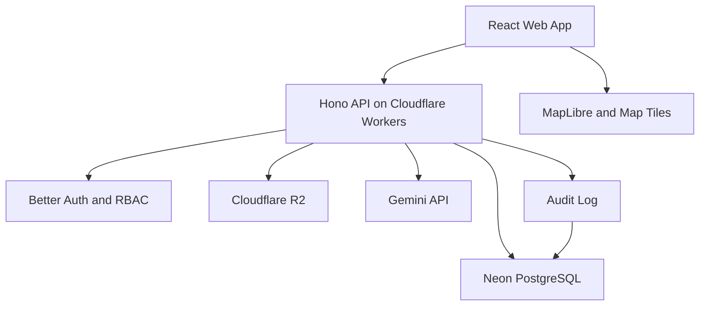

# Technical Architecture — Rangkai

Version: 0.1.0
Status: Proposed implementation

## 1. Architecture Decision

Use one Cloudflare Workers deployment to serve:

- React/Vite static frontend assets.
- Hono API under /api.
- Better Auth routes under /api/auth.

Use Neon PostgreSQL as the primary database.
Use Cloudflare R2 for private file storage.
Use Gemini through server-side API calls only.

No Supabase. No Vercel.

## 2. Technology Stack

Frontend:

- React
- Vite
- TypeScript
- React Router
- TanStack Query
- Tailwind CSS
- shadcn/ui
- MapLibre GL JS

Backend:

- Cloudflare Workers
- Hono
- TypeScript
- Zod
- Better Auth

Data:

- Neon PostgreSQL
- PostGIS
- Drizzle ORM / Drizzle Kit
- Cloudflare R2

AI:

- Gemini Flash multimodal API
- Structured JSON extraction
- Zod runtime validation
- Human-in-the-loop review

Testing:

- Vitest
- Playwright
- Database integration tests

## 3. Logical Architecture



## 4. Repository Structure

```text
rangkai/
├── AGENTS.md
├── docs/
├── src/
│   ├── app/
│   ├── components/
│   ├── features/
│   │   ├── auth/
│   │   ├── events/
│   │   ├── documents/
│   │   ├── traffic/
│   │   ├── cleanup/
│   │   └── public/
│   ├── lib/
│   └── styles/
├── worker/
│   ├── index.ts
│   ├── routes/
│   ├── middleware/
│   ├── services/
│   └── validators/
├── db/
│   ├── schema/
│   ├── migrations/
│   └── seed/
├── tests/
│   ├── unit/
│   ├── integration/
│   ├── e2e/
│   └── fixtures/
├── public/
├── wrangler.jsonc
├── drizzle.config.ts
└── package.json
```

## 5. Runtime Boundaries

Browser:

- Render UI and map.
- Collect user input.
- Display status and uncertainty.
- Never call Gemini with a secret key.
- Never make authorization decisions.

Worker:

- Authenticate requests.
- Enforce RBAC and event assignments.
- Validate inputs and AI outputs.
- Manage R2 uploads.
- Call Gemini.
- Write audit logs.
- Query database.

Database:

- Persist normalized domain data.
- Enforce referential integrity.
- Enforce unique constraints.
- Store road geometry in PostGIS.

## 6. Database Connectivity

Use Neon serverless-compatible connection methods
supported by Cloudflare Workers.

- Worker runtime: use `@neondatabase/serverless` with `drizzle-orm/neon-http`
  to execute stateless HTTP queries without persistent TCP or WebSocket connections.
- Atomic mutations: `neon-http` does not support interactive multi-roundtrip
  transactions (`db.transaction()`), but supports atomic batched execution
  via `db.batch([ ... ])` in a single server-side transaction.
- Migrations and CLI scripts: `pnpm db:migrate` runs programmatic migrations
  via `src/db/migrate.ts` using `@neondatabase/serverless` `Pool` and transactional `drizzle-orm/neon-serverless/migrator` over unpooled
  endpoints (stripping `-pooler.` from the hostname). `drizzle.config.ts` is
  reserved for schema generation (`pnpm db:generate`).
- PostGIS: enabled via `CREATE EXTENSION IF NOT EXISTS postgis;` in migrations;
  geometries are strongly typed in Drizzle via custom geometry types and
  indexed with GIST.
- Development branch guard: The migration runner (`src/db/migrate.ts`), seed
  script (`src/db/seed.ts`), and test harnesses enforce a fail-closed preflight
  check (`assertDevBranch`) verifying `current_setting('neon.branch_id', true) === 'br-wandering-paper-aogdxs48'`
  with pinned connection resolution before any mutation or migration write.
- Database catalog verification: `verifyDatabase` strictly asserts expected
  Neon branch, PostGIS 3.x, 17+ core tables, 2 geometry columns (Point & LineString
  with SRID 4326), 10 required indexes (table ownership, gist/btree method, column order),
  and 12 required constraints (table ownership, types, definitions including
  ON DELETE RESTRICT on road status history), failing nonzero on missing or
  malformed catalog metadata.

## 7. Geospatial Strategy

MVP:

- Define one pilot coverage area.
- Seed manually reviewed road segments.
- Store geometry as PostGIS LINESTRING, SRID 4326.
- Let organizer select exact affected segments.
- Use fuzzy text matching only to suggest candidates.

P1:

- Expand validated road network.
- Introduce graph-based route calculation.
- Add deterministic time/segment conflict detection.

Never assume OSM width tags are complete or accurate.

## 8. Status Synchronization

MVP uses TanStack Query polling:

- Active public event: every 30 seconds.
- Admin and officer: refresh after mutations.
- Inactive page: reduce polling.

A successful write returns the authoritative state.
The UI must not show success before confirmation.

SSE/WebSockets are not required for MVP.

## 9. File Handling

Supported:

- JPEG
- PNG
- PDF

Initial maximum size: 8 MB per file.
This is a configurable product limit.

Upload flow:

1. Authenticate organizer/officer.
2. Validate MIME, extension, and file size.
3. Store private object in R2.
4. Save metadata in PostgreSQL.
5. Return an opaque document ID.

Never expose raw private R2 object keys publicly.
Use controlled access to private documents.

## 10. AI Processing

MVP:

- User starts extraction.
- Worker calls Gemini.
- Structured result is validated.
- Result is saved as a review draft.
- User corrects and approves fields.

For larger PDFs or slow processing:

- Return an extraction job ID.
- Process asynchronously using Cloudflare Queues (P1).
- Poll job status.

Do not block critical road-status updates on AI availability.

## 11. Deployment Environments

Local:

- Vite/Workers local development.
- Single origin serving React SPA and Hono API (Worker-first routing for /api/*).
- Health endpoint: GET /api/health (process liveness).
- Neon development branch.
- R2 development bucket.

Staging:

- Separate database and storage.
- Test users and simulated events.
- Publicly labeled as non-operational.

Production:

- Cloudflare Workers custom domain.
- Production Neon database.
- Production R2 bucket.
- Secret-based API configuration.
- Initial deployment is pending user authorization and remote provisioning.

Never share production credentials with preview branches.

## 12. Observability

Record:

- Request ID
- Route and status code
- Duration
- AI model and latency
- AI error category
- Mutation actor and event ID

Avoid storing document text or personal information
in general-purpose application logs.

## 13. Failure Behavior

Gemini down -> manual event entry.
Neon down -> clear unavailable state, no fake updates.
R2 down -> upload retry, preserve unsaved form.
Map tiles down -> text list of affected roads.
No road match -> manual selection, no guessed segment.
Stale road status -> display unconfirmed.
Offline officer -> do not pretend update was published.

## 14. Performance Strategy

- Lazy-load map components.
- Compress and resize images before upload when possible.
- Use paginated event queries.
- Index public event time/status queries.
- Cache only safe public read responses.
- Never cache private documents publicly.
- Measure actual performance before claiming targets met.
