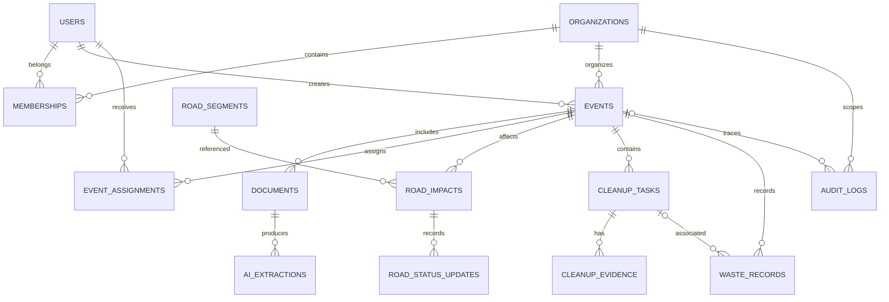

# Entity Relationship Diagram — Rangkai

Version: 0.1.0
Database: Neon PostgreSQL + PostGIS
ORM: Drizzle

## 1. Entity Relationship Diagram



Better Auth also maintains its own account, session,
and verification tables. Those are omitted from this
domain diagram for clarity.

## 2. Core Tables

### organizations

- id: uuid PK
- name: text NOT NULL
- village: text NULL
- district: text NULL
- has_operational_authority: boolean DEFAULT false
- created_at: timestamptz

### memberships

- id: uuid PK
- organization_id: uuid FK
- user_id: text FK to auth user
- role: organizer | officer
- created_at: timestamptz

UNIQUE (organization_id, user_id)

### events

- id: uuid PK
- organization_id: uuid FK
- created_by: text FK
- title: text NOT NULL
- category: text NULL
- description: text NULL
- venue_name: text NULL
- starts_at: timestamptz
- ends_at: timestamptz
- status: draft | review | published |
  active | completed | cancelled | archived
- public_slug: text UNIQUE NULL
- permit_reference: text NULL
- verified_by: text NULL
- verified_at: timestamptz NULL
- published_at: timestamptz NULL
- is_simulation: boolean DEFAULT true
- created_at: timestamptz
- updated_at: timestamptz

CHECK (ends_at > starts_at) when both values exist.

### documents

- id: uuid PK
- event_id: uuid FK
- uploaded_by: text FK
- r2_key: text UNIQUE
- original_name: text
- mime_type: text
- size_bytes: integer
- visibility: private
- created_at: timestamptz

### ai_extractions

- id: uuid PK
- document_id: uuid FK
- model_name: text
- prompt_version: text
- schema_version: text
- output_json: jsonb NULL
- status: pending | processing |
  completed | failed
- error_code: text NULL
- latency_ms: integer NULL
- created_at: timestamptz

### road_segments

- id: uuid PK
- display_name: text
- geom: geometry(LineString, 4326)
- coverage_area: text
- verified_by: text NULL
- verified_at: timestamptz NULL
- created_at: timestamptz

### road_impacts

- id: uuid PK
- event_id: uuid FK
- road_segment_id: uuid FK
- planned_from: timestamptz
- planned_to: timestamptz
- impact_type: closure | intermittent |
  narrowing | procession
- diversion_note: text NULL
- created_at: timestamptz

CHECK (planned_to > planned_from).

### road_status_updates

- id: uuid PK
- road_impact_id: uuid FK (ON DELETE RESTRICT - preserves append-only operational history)
- status: open | intermittent | closed | unknown
- observed_at: timestamptz
- expires_at: timestamptz
- updated_by: text FK
- note: text NULL
- mutation_id: uuid UNIQUE
- created_at: timestamptz

Latest status is derived from the newest accepted update.
If expires_at has passed, public status is UNCONFIRMED.
Do not silently insert an OPEN update on expiry.

### event_assignments

- id: uuid PK
- event_id: uuid FK
- user_id: text FK
- can_update_traffic: boolean
- can_update_cleanup: boolean
- created_at: timestamptz

UNIQUE (event_id, user_id)

### invitations

- id: uuid PK
- organization_id: uuid FK
- event_id: uuid FK NULL
- invitation_role: organizer | officer
- recipient_email: text NOT NULL
- token_hash: text UNIQUE
- can_update_traffic: boolean DEFAULT false
- can_update_cleanup: boolean DEFAULT false
- status: pending | accepted | revoked | expired
- accepted_by: text FK NULL
- revoked_by: text FK NULL
- invited_by: text FK
- accepted_at: timestamptz NULL
- revoked_at: timestamptz NULL
- expires_at: timestamptz
- created_at: timestamptz
- updated_at: timestamptz

### cleanup_tasks

- id: uuid PK
- event_id: uuid FK
- title: text
- description: text NULL
- location: geometry(Point, 4326) NULL
- assigned_user_id: text NULL
- status: todo | in_progress |
  submitted | verified | reopened
- due_at: timestamptz NULL
- verified_by: text NULL
- verified_at: timestamptz NULL
- created_at: timestamptz
- updated_at: timestamptz

### cleanup_evidence

- id: uuid PK
- task_id: uuid FK
- uploaded_by: text FK
- r2_key: text UNIQUE
- stage: before | after
- created_at: timestamptz

### waste_records

- id: uuid PK
- event_id: uuid FK
- task_id: uuid NULL FK
- category: organic | recyclable | residual
- quantity_kg: numeric(10,2) NULL
- sack_count: integer NULL
- measurement_method: weighed | estimated
- destination: text NULL
- recorded_by: text FK
- recorded_at: timestamptz

At least one quantity field must be present.
An estimated sack count must not be displayed as
a measured weight.

### audit_logs

- id: uuid PK
- organization_id: uuid FK
- event_id: uuid NULL FK
- actor_id: text NULL
- action: text
- entity_type: text
- entity_id: text
- before_json: jsonb NULL
- after_json: jsonb NULL
- created_at: timestamptz

Audit logs are append-only at application level.

## 3. Database Indexes

- events (organization_id, starts_at)
- events (status, starts_at)
- events (public_slug) UNIQUE
- documents (event_id)
- road_impacts (event_id)
- road_impacts (road_segment_id, planned_from)
- road_status_updates (road_impact_id, created_at DESC)
- cleanup_tasks (event_id, status)
- audit_logs (event_id, created_at DESC)

Spatial indexes:

- GIST on road_segments.geom
- GIST on cleanup_tasks.location

## 4. Integrity Rules

- Organization membership is required for organizer access.
- Field assignments cannot grant permissions outside
  the assigned event.
- Road impacts reference only reviewed road segments.
- A document belongs to exactly one event.
- Event publication requires reviewed core information.
- Deleting a user must not destroy historical audit records.
- Road-status history is append-only: road_status_updates cannot be deleted or cascadingly deleted via road_impacts (ON DELETE RESTRICT).
- Finite domain values are enforced via CHECK constraints on memberships (role), events (status), ai_extractions (status), road_impacts (impact_type), road_status_updates (status), cleanup_tasks (status), cleanup_evidence (stage), and waste_records (category, measurement_method).
- Private file objects must never be exposed through
  public event API responses.

## 5. Migration Strategy

Use Drizzle Kit for ordinary schema changes.
Use SQL migrations for PostGIS and geometry indexes.

Example:

```sql
CREATE EXTENSION IF NOT EXISTS postgis;

CREATE INDEX road_segments_geom_idx
ON road_segments
USING GIST (geom);
```

Run migrations against a development Neon branch first.

- 0000_premium_wallflower.sql: Initial baseline schema, PostGIS extension, spatial & B-tree indexes, Better Auth tables.
- 0001_eager_ben_urich.sql: Additive follow-up applying finite domain CHECK constraints and altering road_status_updates.road_impact_id to ON DELETE RESTRICT.

## 6. Important Design Decisions

- Store timestamps in UTC.
- Render event dates in Asia/Makassar.
- Store road geometry as LineString, not a guessed polygon.
- Use immutable road-status history.
- Derive the current status from history.
- Keep waste measurements separate from AI predictions.
- Keep document content private by default.
