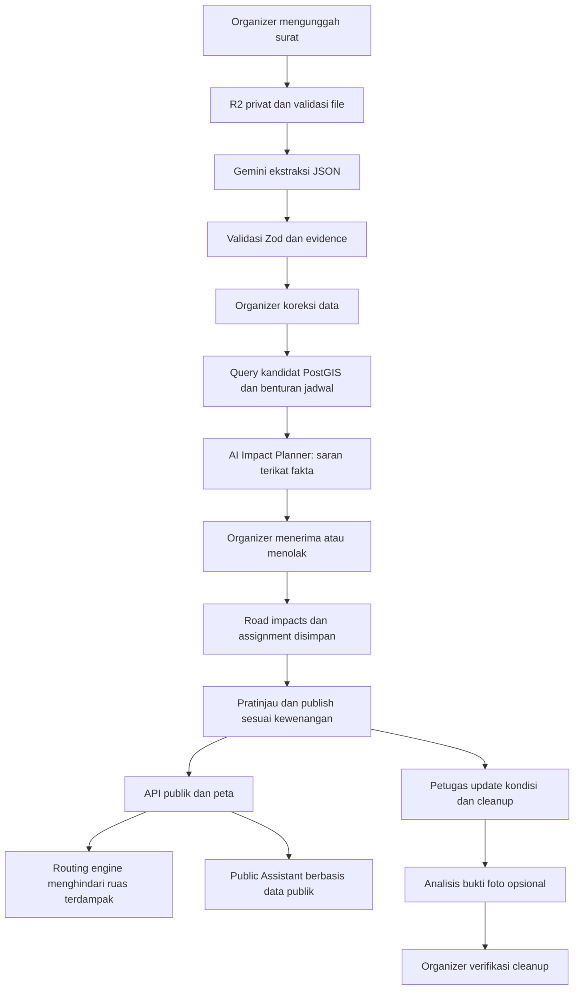
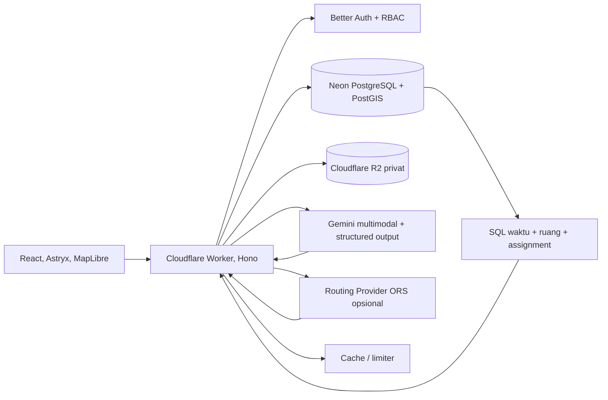

# RANGKAI
## Rencana Pengembangan Produk dan Spesifikasi Teknis untuk Final Bali DigiFest 2026

| Atribut | Keterangan |
|---|---|
| Produk | Rangkai |
| Tim | Skensa Jaya, SMK Negeri 1 Denpasar |
| Versi dokumen | 1.0, 9 November 2026 |
| Target kompetisi | AI Web Innovation Challenge, Bali DigiFest 2026, kategori SMA/SMK/sederajat |
| URL aplikasi | <https://rangkai.skensa.web.id/> |
| Repository | <https://github.com/kasumadana/rangkai> |
| Baseline kode yang diaudit | `main` pada commit `961a0a4d01399a83f58a0cb6050f7b61063f5c61` |
| Tenggat final | 11 November 2026; jam penutupan perlu mengikuti pengumuman panitia |
| Status dokumen | Spesifikasi dan rencana implementasi; **bukan** laporan fitur yang sudah selesai |

> **Penting.** Juknis terlampir masih berstatus **Draft Petunjuk Teknis**. Tanggal pengumuman finalis 9 November dan final submission 11 November ditandai sebagai jadwal yang disepakati. Rubrik final dinyatakan sebagai rekomendasi operasional. Gunakan rubrik ini untuk optimasi, lalu ikuti pembaruan resmi panitia jika ada. Dokumen ini tidak mengubah repository, database, atau deployment.

---

## 0. Ringkasan keputusan produk

**Tesis utama:** Rangkai mengubah dokumen pengumuman kegiatan adat menjadi rencana koordinasi yang diverifikasi manusia, menghubungkan dampak pada ruas jalan dengan pembaruan pecalang dan pertanggungjawaban kebersihan, lalu menyediakan informasi yang dapat dipahami masyarakat.

Fokus peningkatan adalah **satu perjalanan pengguna yang benar-benar berfungsi**:

`Unggah surat -> Ekstraksi Gemini -> Analisis dampak AI -> Verifikasi prajuru -> Ruas jalan pada peta -> Alternatif perjalanan -> Pembaruan pecalang -> Bukti kebersihan -> Informasi publik`.

Keputusan implementasi:

1. **P0, wajib untuk versi final:** stabilkan alur lama, tampilkan garis jalan pada semua tampilan yang relevan, perbaiki status dan TTL, buktikan Gemini dengan dokumen baru, serta jalankan semua role pada deployment.
2. **P1, peningkatan dengan nilai tertinggi:** AI Impact Planner berbasis fakta terverifikasi, *road name candidate matching*, rute alternatif pilot dengan fallback, dan pembuat draf pengumuman publik.
3. **P2, AI tambahan dengan eksperimen terukur:** asisten tanya jawab berbasis data publik, Computer Vision untuk pemeriksaan kualitas bukti foto, serta prakiraan sampah berbasis baseline yang dapat dibuktikan. **Spesifikasi lengkap ada di dokumen ini**, tetapi jangan mengklaim implementasi atau akurasi sebelum lolos evaluasi.
4. **Dilarang sebagai klaim:** AI memberikan izin penutupan jalan, AI menilai jalan pasti aman, AI membuat geometri navigasi dari imajinasi, prediksi kilogram sampah tanpa data, AI mengesahkan kebersihan dari foto, dan respons chatbot yang mengarang kondisi jalan terkini.

### 0.1. Definisi P0, P1, P2

- **P0, Release Blocker:** bila gagal, penjurian dapat melihat aplikasi tidak berfungsi, tidak aman, atau informasinya menyesatkan.
- **P1, High Impact:** memperkuat bobot penilaian bila dapat dituntaskan dan diuji sebelum final. Dapat dimatikan melalui *feature flag* jika tidak stabil.
- **P2, Controlled Stretch:** harus mempunyai spesifikasi, contoh alur, dan rencana evaluasi. Hanya dinaikkan ke demo final jika lulus quality gate P0/P1.

---

## 1. Strategi terhadap rubrik penilaian final

| Kriteria | Bobot final dalam Juknis | Bukti produk yang harus ditunjukkan |
|---|---:|---|
| AI Implementation & Technical Depth | 25% | Gemini bekerja pada dokumen baru; evidence; analisis berbasis fakta; validasi skema; fallback; evaluasi |
| Product Functionality & Reliability | 25% | Alur organizer, petugas, publik, dan cleanup selesai; peta LineString; API; error handling; tes production |
| Problem-Solution Fit & Impact | 15% | Skenario adat Bali; permasalahan informasi jalan dan sampah; hasil pengukuran tugas |
| Innovation & Differentiation | 15% | Document Intelligence + human review + verifikasi geospasial + status kedaluwarsa + accountability |
| UX/UI & Accessibility | 10% | Wizard jelas; mobile petugas; alternatif teks untuk peta; loading/error/empty state; keyboard |
| Scalability & Development Potential | 5% | Multi-organisasi berizin, caching, rate limit, audit, konfigurasi provider, dokumentasi |
| Demo & Communication | 5% | Video maksimal 5 menit, input baru sampai output AI, demonstrasi asli, jawaban technical Q&A |

**Prioritas skor:** 50% penilaian berasal dari AI dan reliabilitas. Jangan menukar pengujian alur utama dengan menambah fitur visual atau AI yang belum dapat diuji. Nilai Tahap 1 tidak dibawa ke final menurut Juknis.

**Catatan sumber:** Juknis halaman 14-17 memuat format video dan technical verification; halaman 16 memuat bobot final. Juknis halaman 11 memuat version locking dan akun demo.

---

## 2. Audit baseline repository, fakta versus gap

Temuan berikut berasal dari pembacaan source code dan laporan QA pada commit baseline. **Bukan hasil pengujian browser terhadap website produksi.** Perubahan setelah commit tersebut harus diaudit ulang.

| Domain | Kondisi yang terverifikasi pada kode | Gap menuju target |
|---|---|---|
| Frontend | React/Vite/TypeScript, Astryx, MapLibre, TanStack Query | Sinkronisasi geometri pada seluruh peta; edge/error states; audit aksesibilitas |
| Auth & organisasi | Better Auth, `memberships` (`organizer`, `officer`), undangan, pembatasan penugasan | Tes live seluruh role; pendaftaran tidak sama dengan kewenangan operasional resmi |
| Event wizard | Empat langkah utama: Surat & AI; Detail & WITA; Peta & Ruas; Verifikasi & Publikasi | Bukti unggah sampai publish dan persistensi end-to-end |
| Gemini | Upload privat; ekstraksi multimodal; Zod; evidence; human review; fallback manual | Kemampuan AI perencanaan belum menjadi modul tersendiri |
| Peta input | `DashboardRoadMapInput.tsx` sudah menggambar `LineString` GeoJSON dan memilih katalog | Cocokkan dengan hasil yang muncul di peta publik setelah publish |
| Beranda | `LandingPage.tsx` memanggil `mapPublicEventToCeremonyProfile(evt, [], idx)` | Array ruas selalu kosong saat dibangun untuk beranda; butuh *road data hydration* |
| Peta publik | `BaliMapTilerView.tsx` sudah menggambar LineString jika `roadSegments` tersedia | Rute semua acara belum tentu termuat karena beberapa view hanya mengambil ruas acara terpilih |
| Rute alternatif | Catatan arah pengalihan (`guidanceNote`/`alternativeRouteSummary`) tersedia sebagai teks | Belum teridentifikasi layanan routing jaringan jalan yang menghitung rute menghindari penutupan |
| Status jalan | `roads.ts` memakai `ROAD_STATUS_TTL_MS = 30 * 60 * 1000` | Proposal dan sebagian microcopy menyebut dua jam; perlu harmonisasi |
| Cleanup | Tugas, foto privat, kategori sampah, `weighed` vs `estimated`, verifikasi/reopen | Belum ada modul AI sampah, CV terukur, atau evaluasi dampaknya |
| QA | Dokumen C06 dan C09 serta banyak tes Playwright dan unit | Laporan C09 berbasis local Cloudflare/Vite; ulangi smoke + happy path pada deployment |
| Dokumentasi | PRD, SRS, AI spec, API contract, runbook, QA report | README masih menyebut `Development baseline` dan shadcn/ui, padahal UI memakai Astryx |

### 2.1. Ketidaksesuaian TTL yang harus diputuskan

`src/worker/routes/roads.ts` memakai **30 menit** untuk masa berlaku status setelah observasi. Variabel batas usia observasi **2 jam** adalah aturan yang berbeda: laporan terlalu lama tidak boleh dikirim seolah baru. Tidak boleh menyamakan kedua angka tersebut.

**Keputusan yang direkomendasikan:** pertahankan TTL server 30 menit sebagai satu-satunya sumber kebenaran. UI menampilkan `expiresAt` dari backend. Jangan hardcode angka 30 menit atau 2 jam pada banyak komponen. Perbarui proposal, disclaimer, UX copy, tes, video, dan QA evidence. Jika tim hendak mengganti TTL, lakukan lewat satu konfigurasi server yang teruji dan perbarui dokumen.

### 2.2. Bukti QA dan batas klaim

- QA C06 mencakup unggah berkas, form manual, navigasi wizard, serta penolakan permintaan tidak sah.
- QA C09 mencatat 14/14 regresi desktop + mobile dan 53/53 unit test lulus pada lingkungan lokal tanggal 8 November 2026.
- Terdapat tes koreksi E2E untuk pendaftaran, undangan, penutupan jalan, kebersihan, dan publikasi simulasi.
- **Belum otomatis membuktikan:** ekstraksi API Gemini pada input baru berjalan end-to-end di domain produksi, routing alternatif bekerja, atau semua alur demo credential tidak gagal di production.

---

## 3. Prinsip produk dan batas keselamatan informasi

1. **Evidence before automation:** Semua fakta yang diklaim AI harus bersumber dari surat atau data terverifikasi dengan referensi. Fakta yang tak tersedia menggunakan `null` atau `unknown`, bukan tebakan.
2. **Human-in-the-loop:** AI hanya menyarankan; publikasi, penentuan dampak jalan, rute alternatif operasional, dan verifikasi kebersihan membutuhkan keputusan manusia berwenang.
3. **Simulation-by-default:** Organisasi baru boleh mencoba simulasi. Publikasi penutupan jalan nyata membutuhkan kewenangan operasional yang diakui backend (`hasOperationalAuthority`).
4. **Stale-is-never-green:** Status jalan yang kedaluwarsa adalah `unconfirmed`, tidak berubah otomatis menjadi `open`.
5. **No false precision:** Durasi routing adalah perkiraan dari mesin rute, bukan kondisi macet real-time. Prakiraan sampah harus memiliki rentang dan metode.
6. **Separation of concerns:** Status jalan, status kegiatan, status verifikasi AI, dan status kebersihan tidak boleh saling menggantikan.
7. **Least privilege:** Role diperiksa server-side dan dibatasi organisasi serta assignment event. Model AI tidak memiliki hak mutasi langsung.
8. **Bali-first usability:** WITA, nama desa/banjar/pura, pembatasan kegiatan simulasi, label Bahasa Indonesia jelas, akses ponsel untuk petugas.
9. **Privacy by design:** Data surat privat, R2 bukan publik, API key server-only, dan tidak mengirim berkas pribadi ke layanan AI tanpa persetujuan serta hak pemrosesan.
10. **Graceful degradation:** Saat Gemini atau map provider gagal, pengguna tetap dapat menyelesaikan tugas manual yang aman.

### 3.1. Non-goals versi final

- Tidak menerbitkan izin jalan resmi atau menggantikan kepolisian/Dishub.
- Tidak menjanjikan navigasi paling aman dalam kondisi fisik jalan yang berubah.
- Tidak memakai AI untuk menebak koordinat jalan dari nama jalan semata.
- Tidak melakukan *auto-verify* foto sebagai bukti area pasti bersih.
- Tidak mengklaim model prediksi sampah terlatih jika data historis yang sah belum cukup.
- Tidak membuat dashboard superadmin baru hanya untuk lomba.

---

## 4. Persona, alur end-to-end, dan halaman

### 4.1. Persona dan otorisasi

| Persona | Akses | Tindakan |
|---|---|---|
| Warga / pengendara | Tanpa login | Cari acara, lihat status ruas, informasi aktualitas, rute alternatif pilot, tanya jawab berbasis data publik |
| Organizer / prajuru | Akun `organizer` pada organisasi | Buat acara, unggah surat, koreksi AI, tambah ruas, tugaskan petugas, review, publish, verifikasi cleanup |
| Pecalang | `officer` + `canUpdateTraffic` pada event | Baca penugasan, ubah kondisi ruas, catat observasi dan waktu |
| Petugas kebersihan | `officer` + `canUpdateCleanup` pada event | Ambil tugas, unggah bukti, catat sampah, submit; menunggu verifikasi |

Pecalang dan petugas kebersihan adalah **izin assignment**, bukan dua role database global. Satu orang dapat menerima dua izin pada event berbeda atau sama.

### 4.2. Halaman yang dipertahankan / diperluas

| URL | Pengguna | Perluasan |
|---|---|---|
| `/` | Publik | Status acara jelas, event dengan ruas valid, tautan detail dan peta |
| `/events`, `/events/:slug` | Publik | Detail, timeline WITA, status, garis ruas, transparansi simulasi |
| `/peta` | Publik | GeoJSON semua event dalam viewport, filter, legenda, fallback daftar ruas |
| `/events/:slug/map` | Publik | Fokus satu acara, garis dampak, rute alternatif, catatan validasi |
| `/login`, `/register` | Anggota | Alur auth jelas, states validasi, error aman |
| `/onboarding/organization`, `/invite/:token` | Anggota | Organisasi/undangan tanpa memberi authority operasional otomatis |
| `/dashboard`, `/dashboard/events` | Organizer | Status pekerjaan, bottleneck review, metrik yang relevan |
| `/dashboard/events/new`, `/dashboard/events/:id` | Organizer | Wizard 4 langkah, AI Impact Planner dan tab pratinjau |
| `/dashboard/events/:id/roads` | Organizer | Geometri dan status, rekomendasi ruas, alternatif yang dapat ditinjau |
| `/dashboard/events/:id/review` | Organizer | Evidence, konflik, keputusan approve/override |
| `/dashboard/events/:id/cleanup` | Organizer | Tugas, rekap sampah, verifikasi foto, prediksi hanya jika valid |
| `/dashboard/events/:id/team` | Organizer | Invite dan penugasan |
| `/field`, `/field/events/:id/...` | Officer | Traffic dan cleanup mobile-first |
| `/assistant` atau panel di peta | Publik, opsional | Chatbot pertanyaan berbasis data publik dengan sitasi |

**Usulan UI baru harus merupakan panel, tab, atau komponen di halaman yang ada** bila tidak membutuhkan navigasi baru. Hindari memperbesar sidebar.

### 4.3. User journey final

1. Organizer membuat acara simulasi, mengunggah surat baru, dan memberi persetujuan pemrosesan AI.
2. Gemini mengembalikan data terstruktur dan evidence; organizer mengoreksi kolom tidak pasti.
3. *Impact Planner* menyajikan ruas kandidat dan konflik berbasis data; organizer memilih atau menolak.
4. Organizer memilih/menggambar ruas simulasi; ruas yang akan dipublikasikan tercatat dengan geometri.
5. Sistem menampilkan pratinjau peta, review, dan hanya mengizinkan publikasi bila valid.
6. Warga membuka portal, melihat ruas serta status aktualitas. Jika pilot routing tersedia, warga dapat mencari alternatif.
7. Pecalang yang ditugaskan mengubah status jalan dan mendapat konfirmasi server.
8. Petugas kebersihan mengunggah foto dan memasukkan kuantitas/metode sampah.
9. Organizer memverifikasi atau membuka kembali tugas. Penutupan jalan tetap independen.
10. Skenario ditutup dengan audit log dan ringkasan hasil tanpa klaim dampak yang belum diukur.

---

## 5. Spesifikasi AI: arsitektur, data, dan provenance

### 5.1. Peta kemampuan AI

| Kode | Modul | Status baseline | Target | Prioritas |
|---|---|---|---|---|
| AI-01 | Gemini Document Intelligence | Ada | Stabil, evidence, benchmark input baru | P0 |
| AI-02 | Road Candidate Matching | Kandidat nama jalan ada, belum rekomendasi matching lengkap | Kandidat katalog dengan alasan dan skor heuristik | P1 |
| AI-03 | Event Impact Planner | Belum modul AI terpisah | Analisis jadwal, risiko informasi, rekomendasi tugas | P1 |
| AI-04 | Public Notice Generator | Belum modul tersendiri | Draf pengumuman berbasis field terverifikasi | P1 |
| AI-05 | Waste Forecast / Waste Planning | Belum | Baseline transparan, model terkalibrasi bila data cukup | P2 |
| AI-06 | Public Grounded Assistant | Belum | Jawaban hanya dari API publik + sitasi | P2 |
| AI-07 | Cleanup Photo Vision | Belum | Penilaian kualitas bukti, bukan pengesahan kebersihan | P2 |

### 5.2. Pipeline yang diusulkan



**Aturan:** Model tidak boleh menulis langsung ke `events`, `road_impacts`, `road_status_updates`, `memberships`, atau `cleanup_tasks`. Model mengembalikan *advisory* terstruktur; perubahan disahkan pengguna melalui API dengan RBAC.

### 5.3. AI-01: Document Intelligence, perbaikan alur lama (P0)

**Input:** dokumen PDF/JPEG/PNG dari R2 privat, disertai metadata MIME, ukuran, consent, event ID, organisasi, dan bahasa. Batas upload menurut codebase saat ini: 8 MB untuk dokumen.

**Proses:** `POST /api/events/:eventId/extractions` memanggil Gemini pada backend dengan prompt tetap dan schema JSON; hasil divalidasi Zod. Output disimpan sebagai rekaman ekstraksi dan draf yang memerlukan review.

**Output:** nama acara, kategori, waktu, lokasi, penyelenggara, kandidat nama jalan, deskripsi dampak, evidence, `needs_review`, dan issues.

**Penyempurnaan:**

- Tampilkan thumbnail/pratinjau dokumen dan kutipan bukti berdampingan dengan setiap field.
- Tandai `Tidak tercantum di surat` jika tidak ada data, bukan mengarang jam selesai.
- Simpan perbandingan `AI suggestion`, `human correction`, `final value` pada audit/log keputusan.
- Bedakan `Extracted`, `Corrected`, `Manually entered`, dan `Needs review` dalam UI.
- Saat timeout/429/503, tampilkan pesan, tombol coba ulang, dan pengisian manual. Jangan membuat event otomatis published.
- Wajib tes dokumen baru yang tidak dipakai sebagai fixture maupun prompt development.

**Acceptance criteria:** minimal satu input baru berhasil dalam deployment; bukti dan isu terlihat; koreksi persisten setelah refresh; kegagalan provider tidak menghalangi alur manual; tidak ada publikasi otomatis.

### 5.4. AI-02: Road Candidate Matching (P1)

**Tujuan:** membantu organizer menemukan segmen PostGIS yang cocok dengan nama jalan dari surat.

**Input faktual:** `affected_road_names` hasil ekstraksi, nama desa/kecamatan, geometri dari katalog yang sudah diberi `verified_by/verified_at`, serta jadwal acara.

**Pipeline:**

1. Normalisasi teks: `Jl.`, `Jln.`, `Jalan`, tanda baca, spasi, dan ejaan umum.
2. Query kandidat terverifikasi di cakupan spasial organisasi atau bbox event.
3. Hitung peringkat deterministik: kesamaan nama, kesesuaian wilayah, jarak ke lokasi kegiatan bila koordinat diketahui.
4. Gemini **opsional** menjelaskan alasan kecocokan menggunakan atribut kandidat yang sudah ditemukan. Gemini tidak membuat ID atau koordinat baru.
5. Organizer memilih segmen secara manual atau menyatakan `Tidak ada yang cocok`.

**Contoh kontrak respons (usulan):**

```json
{
  "eventId": "uuid",
  "query": "Jl. Hasanudin",
  "candidates": [
    {
      "roadSegmentId": "uuid-dari-katalog",
      "displayName": "Jalan Hasanudin",
      "matchScore": 0.82,
      "matchMethod": "name_and_region",
      "reviewRequired": true,
      "explanation": "Nama cocok; batas segmen harus diperiksa pada peta."
    }
  ],
  "selectedRoadSegmentId": null
}
```

`matchScore` adalah **skor heuristik pencocokan**, bukan probabilitas kebenaran model. Segmen yang dikarantina tidak ditampilkan sebagai kandidat terverifikasi. Jangan membuat geometri berdasarkan teks AI.

**Acceptance criteria:** nama identik, variasi singkatan, dua jalan dengan nama sama, kandidat nihil, dan segmen karantina diuji. Tidak ada pemilihan otomatis atau akses organisasi lain tanpa izin.

### 5.5. AI-03: Event Impact Planner (P1, diferensiasi AI utama)

**Tujuan:** mengubah hasil OCR menjadi *draft action plan* untuk pelaksanaan kegiatan, dengan alasan yang dapat ditelusuri.

**Input ke AI setelah validasi server:**

- `verifiedEvent`: nama, waktu WITA, lokasi, kategori, deskripsi, status simulasi.
- `roadCandidates`: ID/nama dan hasil validasi geometris, tanpa mengirim geometri privat penuh bila tidak perlu.
- `deterministicSignals`: konflik jadwal dari SQL, overlap geospasial, status petugas, status ruas terkini, dan data yang masih kosong.
- `policyConstraints`: kewenangan, status simulation, stale road rule, tidak memberi izin resmi.

**Pisahkan dua komponen:**

1. **Rule Engine faktual:** query jadwal bersinggungan `time_overlap = startA < endB AND startB < endA`; query spasial `ST_Intersects` / `ST_DWithin`; cek jumlah petugas, informasi belum diverifikasi, dan ruas yang punya konflik.
2. **Gemini interpretation:** membuat alasan, prioritas kerja, checklist, pertanyaan yang perlu dikonfirmasi, dan draf komunikasi berdasarkan `deterministicSignals` dan evidence yang ditentukan server.

**Contoh output (usulan):**

```json
{
  "version": "impact-plan-v1",
  "eventId": "uuid",
  "mode": "simulation",
  "inputSnapshotHash": "sha256:...",
  "findings": [
    {
      "id": "missing-road-confirmation",
      "type": "unverified_road",
      "severity": "needs_review",
      "factRefs": ["road-candidate:0"],
      "explanation": "Ruas terdampak belum disetujui penyelenggara.",
      "recommendedAction": "Pilih segmen yang sesuai pada peta."
    }
  ],
  "recommendedTasks": [
    {
      "role": "traffic_officer",
      "title": "Tetapkan petugas pemantauan ruas",
      "reasonRefs": ["missing-road-confirmation"],
      "requiresApproval": true
    }
  ],
  "unknowns": ["Jadwal akhir prosesi belum tercantum"],
  "disclaimer": "Rekomendasi persiapan, bukan izin atau jaminan keselamatan."
}
```

**Kriteria kualitas:** semua `factRefs` harus merujuk ke input faktual yang dikirim; jangan ada nama jalan, nomor izin, waktu, atau status jalan yang tidak ada dalam input; JSON valid; tindakan hanya menjadi saran dan tidak mengubah penugasan otomatis.

**Interaksi UI:** kartu `Analisis Dampak AI` setelah organizer memeriksa data. Tombol `Tinjau`, `Terima sebagai checklist`, `Abaikan` dan `Jalankan ulang setelah perubahan data`. Rencana lama harus diberi label *outdated* jika field atau segmen berubah.

**Feature flag:** `AI_IMPACT_PLANNER_ENABLED`. Matikan tanpa memengaruhi alur wizard bila 503, schema invalid, atau latensi tinggi.

### 5.6. AI-04: Public Notice Generator (P1)

**Tujuan:** menghasilkan draf pengumuman warga dan instruksi petugas dari data acara yang telah diverifikasi.

**Syarat input:** event sudah `reviewed` untuk draf, ruas punya status yang jelas, waktu WITA dari server, `isSimulation` selalu diteruskan.

**Output:**

- Ringkasan publik maksimal 120 kata dalam bahasa Indonesia sederhana.
- Pengumuman WhatsApp maksimal 600 karakter.
- Instruksi tugas pecalang dan cleanup berdasarkan assignment aktual.
- Label `SIMULASI` atau `INFORMASI YANG TELAH DIPUBLIKASIKAN` sesuai status resmi di database.
- Referensi `eventId`, `roadImpactIds`, `observedAt/expiresAt` bila menyebut kondisi jalan.

**Batasan:** draf belum otomatis dipublikasikan, tidak menyebut arah pengalihan yang belum diverifikasi, tidak mengarang pengesahan pihak berwenang. Saat status jalan stale, draf wajib menyebut `Belum dikonfirmasi ulang`.

**Acceptance criteria:** generator tidak membuat ruas tambahan, label simulasi tidak hilang, semua nama/waktu cocok dengan data tersimpan, organizer dapat mengedit dan menyetujui.

### 5.7. AI-05: Waste Forecast dan Waste Planning (P2, spesifikasi penuh)

**Masalah:** organizer ingin menyiapkan kebutuhan tim dan pengelolaan sampah sebelum acara. Data existing mengandung `category`, `quantityKg`, `sackCount`, dan `measurementMethod` (`weighed` atau `estimated`); data ini **belum otomatis cukup** untuk model prediksi yang valid.

**Desain dua tahap:**

**Tahap A, Waste Planning Assistant (bisa dibuat tanpa model prediktif):**

- Organizer mengisi rentang jumlah peserta, durasi, jenis acara, jumlah titik kegiatan, dan perkiraan fasilitas/penjual (jika ada).
- Sistem menampilkan checklist pemilahan, lokasi titik pengumpulan, kebutuhan dokumentasi, serta **skenario** jumlah karung/berat yang didasarkan pada asumsi yang diisi pengguna atau data historis terverifikasi.
- Hasil harus berlabel `Estimasi perencanaan berbasis asumsi`, bukan `Prediksi AI terlatih`.
- Gemini dapat merangkum penjelasan dan mengusulkan checklist, tetapi **tidak** boleh menghasilkan berat sampah numerik tanpa metode yang jelas.

**Tahap B, Forecasting model bila tersedia data historis memadai:**

- Target: `organic_kg`, `recyclable_kg`, `residual_kg` terpisah; semua target berasal dari pengukuran `weighed` yang terdokumentasi.
- Fitur kandidat: kategori acara, jumlah peserta atau rentang, durasi, jumlah lokasi, jumlah pedagang, lokasi, cuaca historis jika berizin, dan pola acara sebelumnya.
- Split train/test berdasarkan **event**, bukan foto atau baris catatan dari event yang sama. Hindari kebocoran data.
- Minimal eksplorasi setelah sekurang-kurangnya 30 event berlabel yang sah; klaim akurasi produksi baru layak ditinjau setelah sampel independen cukup dan *baseline* sederhana terkalahkan. Angka 30 merupakan **ambang eksplorasi rencana**, bukan standar ilmiah performa.
- Baseline pembanding: median kilogram per acara pada kategori serupa; serta per-peserta bila tersedia.
- Metode kandidat: regularized regression / gradient boosted trees dengan regularisasi dan validasi silang kelompok; tidak perlu deep learning.
- Metrik: MAE per kategori, WAPE dengan penanganan denominator nol, bias rata-rata, coverage interval prediksi, dan perbandingan dengan baseline.
- Output: `estimatedKgRange`, `method`, `sampleSize`, `dataQuality`, `lastTrainedAt`, dan disclaimer. Jika data kurang, kembalikan `insufficient_data`, bukan angka sintetis.
- Nilai yang diestimasi dan ditimbang tidak digabung seolah setara dalam evaluasi model.

**Contoh respons (usulan):**

```json
{
  "status": "insufficient_data",
  "method": "planning_assumptions",
  "sampleSize": 0,
  "scenarioAssumptions": {
    "attendeesMin": 150,
    "attendeesMax": 250,
    "durationHours": 4
  },
  "forecastKg": null,
  "planningChecklist": ["Siapkan titik pemilahan organik, daur ulang, residu"],
  "requiresHumanReview": true
}
```

**Risiko utama:** AI mengeluarkan angka tanpa basis, data `estimated` dipakai sebagai *ground truth*, dan kategori sampah disalahklasifikasi. Semua dicegah lewat validasi dan pemisahan sumber data.

**Quality gate:** tanpa data valid, modul hanya planning checklist; untuk angka forecast, harus ada baseline, evaluasi holdout, dan dokumentasi error. Jangan memaksakan forecast demi demo.

### 5.8. AI-06: Public Grounded Assistant (P2, chatbot yang relevan)

**Bukan chatbot umum.** Asisten hanya menjawab pertanyaan mengenai informasi kegiatan yang **sudah dipublikasikan**, status ruas yang tersedia, waktu observasi, dan ringkasan kebersihan publik.

**Contoh pertanyaan:**

- "Ada upacara apa di Denpasar minggu ini?"
- "Jalan mana yang terdampak kegiatan X?"
- "Kapan informasi kondisi jalan terakhir diperbarui?"
- "Apakah ada rute alternatif?" Jawab hanya jika rute yang disetujui atau hasil routing tervalidasi tersedia.

**Arsitektur retrieval:**

1. Query dinormalisasi dan dikategorikan `event_lookup`, `road_status`, `cleanup_summary`, `route_help`, atau `out_of_scope`.
2. Server mengambil fakta dari endpoint/tabel publik yang sama dengan halaman web; jangan mengambil surat R2 privat, data undangan, nomor telepon pribadi, atau anggota organisasi.
3. Bangun *context package* dengan `sourceId`, `publicUrl`, waktu, `isSimulation`, `status`, `observedAt`, dan `expiresAt`.
4. Gemini menghasilkan jawaban singkat dan daftar referensi `sourceId` yang ada. Server memverifikasi referensi tersebut.
5. Jika informasi tidak ditemukan atau telah kedaluwarsa, asisten mengatakan `Informasi tidak tersedia/belum dikonfirmasi ulang` dan menampilkan tautan halaman acara/peta.

**Tidak perlu vector DB untuk MVP** jika data publik masih terbatas dan terstruktur. Gunakan query PostgreSQL, full-text search/LIKE, dan filter tanggal/lokasi; tambahkan embeddings hanya jika dibuktikan perlu.

**Contoh respons:**

```json
{
  "answer": "Ada satu kegiatan simulasi yang dipublikasikan pada wilayah pencarian. Status ruas terkait belum dikonfirmasi ulang.",
  "answerStatus": "partial",
  "sources": [
    {
      "type": "event",
      "id": "uuid",
      "url": "/events/slug-event",
      "observedAt": null,
      "isSimulation": true
    }
  ],
  "updatedAt": "2026-11-09T03:00:00Z",
  "cannotConfirmSafety": true
}
```

**Pembatasan:** `GET/POST` publik read-only, rate limit, token budget, input moderation, audit agregat tanpa menyimpan teks lengkap secara default, tidak memberikan petunjuk melewati penutupan jalan, dan tidak memberi jawaban seolah live bila datanya stale.

**Evaluasi minimal:** 20 pertanyaan terkurasi termasuk 5 adversarial (meminta data privat, izin palsu, bypass penutupan, status stale, info yang tidak ada). Target acceptance: 0 kebocoran privat; 0 sumber fiktif; seluruh klaim faktual utama memiliki referensi; abstention benar pada unknown.

### 5.9. AI-07: Computer Vision untuk bukti kebersihan (P2, multimodal Gemini)

**Fungsi yang berguna:** menilai **kualitas dokumentasi** sebelum petugas mengirim laporan, bukan memutuskan bahwa area pasti bersih.

**Input:** foto `before` dan `after` yang diunggah ke R2 privat, metadata task, lokasi kegiatan yang diizinkan, consent dan hak akses. Jangan mengunggah foto wajah/plat nomor yang tidak perlu; tampilkan petunjuk framing aman.

**Output terstruktur:**

```json
{
  "taskId": "uuid",
  "photoQuality": {
    "beforeReadable": true,
    "afterReadable": true,
    "sameAreaLikely": "uncertain",
    "issues": ["Sudut foto berbeda, perlu pemeriksaan manual"]
  },
  "visibleObservations": [
    "Terdapat objek yang menyerupai sisa material pada sisi kanan foto"
  ],
  "wasteWeightKg": null,
  "automaticallyVerified": false,
  "requiresOrganizerReview": true
}
```

**UI:** tombol `Periksa kelengkapan foto dengan AI` setelah kedua foto terunggah; tampilkan checklist *before ada / after ada / resolusi cukup / potensi perbedaan sudut* dan peringatan bahwa hasil AI dapat keliru. Organizer tetap memeriksa foto asli dan menyetujui atau reopen.

**Evaluasi:** minimal 20 pasangan foto berizin dengan label manusia, termasuk foto gelap, blur, sudut berbeda, foto salah acara, dan area yang memang belum bersih. Laporkan confusion matrix kualitas/bukti; hindari klaim kilogram sampah berbasis foto.

**Privacy:** gunakan berkas sementara dari R2 privat, minimalkan retensi AI output, hapus metadata EXIF lokasi bila tidak diperlukan, jangan memublikasikan foto privat, dan batasi pemrosesan pada organizer atau petugas penugasan yang berhak.

---

## 6. Fungsionalitas geospasial: dari garis ruas ke rute alternatif

### 6.1. MAP-01: Satu sumber data ruas untuk seluruh antarmuka (P0)

**Masalah aktual:** Renderer LineString sudah tersedia, tetapi pada beranda, profil kegiatan dibuat dengan `mapPublicEventToCeremonyProfile(evt, [], idx)`. Peta utama belum selalu menerima `roadImpacts` yang sesuai. `/peta` mengambil roads untuk acara aktif, bukan otomatis semua acara yang terlihat pada viewport.

**Rancangan:**

- Tambahkan endpoint agregat publik `GET /api/public/road-impacts?bbox=<west,south,east,north>&from=&to=&limit=` yang hanya mengembalikan geometri layak publik.
- Atau, untuk pilot dengan sedikit acara, lakukan *batch fetch* `GET /api/public/events/:slug/roads` melalui TanStack Query dan cache; batasi concurrency. Pilihan endpoint agregat lebih scalable.
- Output GeoJSON FeatureCollection; `properties` memuat `eventId`, `slug`, `roadImpactId`, `displayName`, `impactType`, `effectiveStatus`, `observedAt`, `expiresAt`, `isSimulation`, `isStale`.
- Render layer global pada beranda, `/peta`, dan detail acara; filter berdasarkan `bbox`, interval, dan pilihan pengguna.
- Pastikan event simulasi berlabel SIMULASI dan geometri simulasi tidak disajikan sebagai penutupan resmi.
- Bila segmen tanpa koordinat, jangan membuat garis fiktif; tampilkan daftar tekstual dan pesan `Geometri belum tersedia`.

**Acceptance criteria:** satu acara dengan dua ruas menghasilkan dua fitur GeoJSON yang sama di ketiga tampilan; klik ruas menampilkan status serta waktu; tidak ada layer duplikat ketika pindah event; status stale tidak hijau.

### 6.2. MAP-02: Input dan validasi garis ruas (P0)

- Gunakan LineString dalam format `[longitude, latitude]` sesuai GeoJSON.
- Gambar garis hanya pada mode simulasi atau cakupan yang diizinkan backend.
- Periksa dua titik minimum, titik valid dalam koordinat geografis, panjang masuk akal, titik berulang, dan batas wilayah pilot.
- Jalan yang digambar organizer **tidak otomatis** naik menjadi katalog geospasial terverifikasi.
- Tampilkan preview garis dan nama ruas sebelum simpan.
- Penghapusan/edit ruas pada event berstatus review harus membatalkan review lama dan memerlukan review ulang.

### 6.3. ROUTE-01: Rute alternatif manual terverifikasi (P1 fallback wajib)

Sebelum routing otomatis stabil, organizer boleh memilih atau menggambar rute alternatif **simulasi** dan mengirimkan catatan pengalihan. Rute ini memiliki `provenance = organizer_approved`, timestamp, versi, dan status penerapan. Pada kegiatan nyata, persetujuan operator berwenang merupakan prasyarat tersendiri.

**UI:** pada tab jalan tersedia `Tambah Alternatif`, `Gambar/Impor GeoJSON`, `Pratinjau`, `Simpan Draf`, `Setujui`, serta `Cabut`.

**Tidak boleh:** menampilkan rute manual sebagai rekomendasi mesin navigasi, atau memakai garis lurus sebagai pengganti jalan yang dapat dilalui.

### 6.4. ROUTE-02: Mesin routing jaringan jalan (P1 jika layak)

**Kandidat utama:** openrouteservice (ORS), profil sesuai kendaraan. API mendukung `options.avoid_polygons` berupa GeoJSON Polygon/MultiPolygon. Pertimbangkan kuota dan batas hosted service, atau fallback manual. MapLibre adalah *renderer*, bukan mesin routing.

**Pipeline backend:**

1. Terima asal, tujuan, mode transportasi, dan konteks event; validasi koordinat serta cakupan pilot.
2. Kumpulkan ruas `closed` atau area penghindaran yang perlu dibatasi. Status `unconfirmed` dan `intermittent` diperlakukan konservatif dan diberi kebijakan eksplisit, bukan dianggap aman.
3. Buat polygon buffer dari garis ruas di sistem koordinat meter. Contoh untuk Bali: transformasi dari EPSG:4326 ke EPSG:32750, `ST_Buffer` sejumlah meter, lalu transformasi kembali ke EPSG:4326. Besar buffer adalah **parameter rekayasa**, bukan lebar penutupan yang otomatis benar.
4. Union polygon, validasi geometri, luas, dan cakupan, lalu kirim ke ORS `options.avoid_polygons` melalui server. Jangan membocorkan API key ke browser.
5. Dapatkan GeoJSON network route, jarak, dan estimasi waktu.
6. Verifikasi geometri hasil tidak melintasi area yang harus dihindari. Jika gagal, jangan sajikan sebagai alternatif valid.
7. Sajikan status `candidate`, `simulation`, atau `organizer_approved`, timestamp pembentukan, batas data, dan sumber penyedia rute.
8. Cache berdasarkan asal/tujuan yang dikuantisasi, mode, dan hash daftar penutupan/status; invalidasi saat status berubah atau kedaluwarsa.

**Endpoint usulan:** `POST /api/public/routes/alternatives`. Karena publik dapat memicu biaya eksternal, gunakan rate limit per IP/tenant, batas area pilot, TTL cache singkat, dan maksimum satu atau dua alternatif per permintaan.

**Contoh input:**

```json
{
  "origin": [115.2121, -8.6705],
  "destination": [115.2240, -8.6625],
  "profile": "driving-car",
  "eventSlug": "kegiatan-pilot-simulasi",
  "avoidPolicy": "closed_and_unconfirmed"
}
```

**Contoh output:**

```json
{
  "status": "candidate",
  "isSimulation": true,
  "route": {
    "type": "Feature",
    "properties": { "distanceMeters": 2400, "durationSecondsEstimated": 480 },
    "geometry": { "type": "LineString", "coordinates": [[115.2121, -8.6705], [115.2240, -8.6625]] }
  },
  "avoidedImpactIds": ["uuid"],
  "routingProvider": "openrouteservice",
  "checkedAt": "2026-11-09T05:00:00Z",
  "warnings": ["Contoh simulasi. Tidak menjamin kondisi lalu lintas aktual."],
  "requiresHumanApprovalForOperationalUse": true
}
```

> Nilai koordinat, jarak, dan waktu di atas **hanya contoh struktur JSON**, bukan rute yang dihitung atau klaim jalan nyata.

**Kondisi gagal:** tidak ada koordinat asal/tujuan; polygon terlalu besar; provider 429/503; tidak ada rute; route masih berpotongan dengan zona penghindaran; status jalan terlalu lama. UI menampilkan `Alternatif otomatis belum tersedia` dan mengarahkan ke informasi pengalihan yang disetujui organizer.

**Acceptance criteria:** untuk fixture pilot yang diketahui memiliki lintasan alternatif, rute tidak memotong polygon penutupan; 0 garis lurus palsu; semua respons tidak berisi API key; waktu estimasi berlabel; layanan gagal tanpa menghilangkan tampilan ruas.

### 6.5. ROUTE-03: Bagaimana AI mendukung, bukan menggantikan routing

Gemini menerima **hasil routing yang sudah dihitung dan divalidasi**, lalu dapat membuat penjelasan sederhana: "Alternatif ini menghindari ruas X berdasarkan status yang tercatat pada waktu Y". Jika hasil tidak tersedia, AI harus menolak memberi rute spesifik. Jangan meminta Gemini menghasilkan GPS polyline atau instruksi jalan dari pengetahuan umum.

### 6.6. Peta dan UX

- Legenda terpisah: merah = ditutup; oranye = buka-tutup; abu-abu = belum terkonfirmasi; hijau = terbuka sesuai laporan terbaru; ungu/biru = kandidat alternatif; garis putus = simulasi.
- Selalu tampilkan label teks, bukan hanya warna.
- Klik garis menampilkan nama ruas, sumber status, `observedAt` WITA, `expiresAt` WITA, dan apakah simulasi.
- Sediakan tampilan tabel ruas ketika MapLibre gagal, tile tidak termuat, atau WebGL tidak didukung.
- Jangan paksa pengguna memberikan lokasi GPS; izinkan memilih titik manual. Lokasi GPS hanya dengan izin dan digunakan sesaat.
- Responsif 320, 390, 768, 1280 px. Tombol utama minimal sekitar 44px target sentuh, fokus keyboard terlihat.

---

## 7. Arsitektur aplikasi target



**Pisahkan kode:**

- `src/worker/services/impact-planner.ts`: input builder, prompt, schema validation, sanitized result.
- `src/worker/services/road-matcher.ts`: pencocokan deterministik dan lookup PostGIS.
- `src/worker/services/route-planner.ts`: provider adapter, cache, geometri dan fail-safe.
- `src/worker/services/public-assistant.ts`: retrieval publik, grounding dan validasi sitasi.
- `src/worker/services/waste-planning.ts`: baseline/forecast model adapter.
- `src/worker/services/photo-assessment.ts`: analisis kualitas bukti foto dengan Gemini.
- `src/worker/validators/*`: Zod schema input-output masing-masing modul.
- `src/react-app/features/ai/*`, `features/routes/*`, `features/cleanup-ai/*`: komponen UI dipisahkan dari halaman besar.

Nama file baru ini merupakan **usulan**, bukan file yang sudah ada. Hindari menambah dependencies berat atau merombak struktur proyek sebelum final.

### 7.1. Kontrak API ringkas: existing versus proposed

| Method | Endpoint | Status | Role | Fungsi |
|---|---|---|---|---|
| POST | `/api/events/:id/extractions` | Existing | Organizer | Ekstraksi surat Gemini |
| GET | `/api/extractions/:id` | Existing | Organizer | Status dan hasil AI |
| GET | `/api/road-segments` | Existing | Organizer | Katalog terverifikasi |
| GET | `/api/public/events/:slug/roads` | Existing | Public | Geometri dan status acara |
| POST | `/api/road-impacts/:id/status` | Existing | Assigned traffic | Status jalan |
| POST | `/api/events/:id/waste-records` | Existing | Organizer / assigned cleanup | Data sampah |
| GET | `/api/public/road-impacts` | **Proposed P0** | Public | Agregasi GeoJSON viewport |
| GET | `/api/events/:id/road-candidates` | **Proposed P1** | Organizer | Kandidat road matching |
| POST | `/api/events/:id/impact-analysis` | **Proposed P1** | Organizer | Generate/re-generate AI advisory |
| POST | `/api/events/:id/public-notice-draft` | **Proposed P1** | Organizer | Draf pengumuman |
| POST | `/api/public/routes/alternatives` | **Proposed P1** | Public, rate-limited | Network detour candidate |
| POST | `/api/events/:id/waste-plan` | **Proposed P2** | Organizer | Checklist/rentang berbasis data |
| POST | `/api/public/assistant/questions` | **Proposed P2** | Public, rate-limited | Jawaban berbasis data publik |
| POST | `/api/cleanup-tasks/:id/photo-assessment` | **Proposed P2** | Organizer / assigned cleanup | Pemeriksaan kualitas foto |

**Standar API baru:** Zod input, Zod output, auth sebelum mutation, CSRF/Origin protection untuk endpoint yang relevan, batas body, timeout, rate limit, JSON error stabil (`code`,`message`,`requestId`), audit event untuk rekomendasi yang disetujui/ditolak, dan no-cache untuk respons privat.

### 7.2. Perubahan database yang disarankan

Gunakan migrasi Drizzle terpisah dan *additive*, jangan mengubah migration lama yang sudah dipakai produksi. Tabel berikut merupakan usulan model, bukan keharusan membangun semua sebelum final.

| Tabel baru | Kolom penting | Tujuan |
|---|---|---|
| `ai_advisory_runs` | `id`, `event_id`, `organization_id`, `kind`, `input_hash`, `model`, `prompt_version`, `output_json`, `status`, `latency_ms`, `created_by`, `created_at` | Jejak rekomendasi Impact/Notice/Waste dan versi fakta |
| `ai_advisory_decisions` | `id`, `advisory_id`, `item_id`, `decision`, `reason`, `actor_id`, `created_at` | Catatan approve/reject/override |
| `route_suggestions` | `id`, `event_id`, `route_type`, `origin`, `destination`, `route_geom`, `provider`, `status`, `avoid_hash`, `reviewed_by`, `reviewed_at`, `expires_at` | Rute kandidat, manual, approved, expired |
| `photo_assessments` | `id`, `task_id`, `before_evidence_id`, `after_evidence_id`, `output_json`, `review_required`, `created_at` | Audit assist CV tanpa memutuskan verifikasi otomatis |
| `waste_forecast_models` (lanjutan) | `id`, `version`, `sample_size`, `baseline_metrics_json`, `model_metrics_json`, `trained_at` | Metadata model setelah data tersedia |

**Invariant database:** `route_suggestions` disimpan sebagai geometri LineString/PostGIS bila sudah disetujui; validasi SRID; relasi event/org; `FOREIGN KEY` dan indeks pada event/time; *schema migrations* harus dapat dijalankan ulang pada database staging tanpa merusak data.

**Minimal untuk deadline:** bila Impact Planner hanya perlu menampilkan hasil draf, simpan output dalam satu tabel `ai_advisory_runs` dan jangan menambah tabel lain sampai fitur benar-benar diperlukan.

---

## 8. RBAC, keamanan, AI governance, dan perlindungan data

| Operasi | Public | Organizer organisasi sendiri | Assigned officer |
|---|---|---|---|
| Membaca informasi event yang published | Ya | Ya | Ya |
| Membaca surat/foto privat | Tidak | Sesuai hak | Sesuai tugas dan kebijakan |
| Meminta AI ekstraksi surat | Tidak | Ya, dengan consent | Tidak |
| Menjalankan Impact Planner | Tidak | Ya | Tidak |
| Menyetujui rekomendasi AI | Tidak | Ya | Tidak |
| Meminta routing publik | Ya, rate limited | Ya | Ya |
| Memperbarui status jalan | Tidak | Hanya jika aturan server mengizinkan | Izin traffic pada event |
| Mengirim bukti kebersihan | Tidak | Sesuai aturan | Izin cleanup pada event |
| Memverifikasi cleanup | Tidak | Ya | Tidak |

### 8.1. Kontrol wajib

- Secret `GEMINI_API_KEY`, `DATABASE_URL`, `BETTER_AUTH_SECRET`, dan routing key hanya pada secrets Worker. Audit riwayat Git sebelum membuat repository public.
- Tidak menampilkan demo credentials pada README atau screenshot publik. Form resmi panitia dipakai untuk akun juri.
- `organizationId` dari browser tidak otomatis dipercaya. Backend mengambil/mengecek membership.
- Organisasi baru: `hasOperationalAuthority = false`; hanya dapat simulasi hingga ada verifikasi kewenangan operasional terpisah.
- Semua output AI melalui schema validation dan filter field tak dikenal; lakukan *server-side factRef validation*.
- Lindungi terhadap prompt injection dalam dokumen, caption foto, dan pertanyaan chatbot: instruksi dari berkas dianggap data, tidak dapat mengubah sistem atau izin.
- Pembatasan unggah sesuai jenis/ukuran aktual; scan metadata dan pembatasan MIME. Hapus EXIF jika tak perlu.
- Rate limit untuk AI dan routing; *timeout* dan *circuit breaker* sederhana; jangan melakukan retry tanpa batas.
- Audit perubahan status jalan, publish, koreksi AI, dan verifikasi cleanup.
- AI provider error dilaporkan secara umum tanpa stack trace, token, payload surat, atau informasi pribadi.
- Model tidak diberi hak akses langsung ke kredensial/database produksi.

### 8.2. Risiko penyalahgunaan dan mitigasi

| Risiko | Mitigasi |
|---|---|
| Pengguna baru mengaku mewakili desa resmi | Organisasi baru hanya simulasi; hak operasional tetap terbatas |
| AI memilih jalan salah | Candidate-only; katalog, geometri, persetujuan manual |
| Chatbot mengklaim jalan aman walau stale | Status dibaca dari backend; stale memicu abstention |
| AI menyatakan sampah pasti sudah bersih | CV hanya cek kualitas bukti; final keputusan organizer |
| Forecast kilogram tanpa data | Kembalikan `insufficient_data` dan checklist |
| Routing API mahal/dipakai bot | Cache, scope pilot, rate limit, key server-only |
| Rahasia bocor di repo | Secret scanning dan rotasi kunci bila terlanjur commit |
| Surat berisi data pribadi diproses tanpa izin | Consent, provenance, minimisasi input, pembatasan akses |
| Uji QA mengubah database produksi | Database staging dan akun simulasi terisolasi |

---

## 9. UI/UX dan aksesibilitas per alur

### 9.1. Organizer wizard

Pertahankan empat layar utama:

1. **Surat & AI:** upload, consent, progress ekstraksi, evidence, retry/manual.
2. **Detail & WITA:** field dari AI yang bisa dikoreksi, validasi tanggal, indikator field uncertain.
3. **Peta & Ruas Jalan:** kandidat ruas, pilih katalog/gambar simulasi, garis terlihat, alternatif rute pilot.
4. **Verifikasi & Publikasi:** ringkasan data, AI impact findings, konflik, petugas, label simulasi, konfirmasi.

Checklist kebersihan dan penugasan sebaiknya berupa tab atau *post-publish workflow* yang mudah ditemukan, bukan memaksa tujuh halaman wizard jika kodenya empat langkah.

### 9.2. Petugas lapangan

- Layar awal menampilkan hanya tugas milik pengguna dan kegiatan yang aktif/relevan.
- Aksi traffic `Buka`, `Buka-tutup`, `Tutup` dengan konfirmasi, lokasi/nama ruas, catatan, waktu observasi WITA dan durasi dari server.
- Tampilkan status `Mengirim...`, `Berhasil tersimpan`, `Gagal, coba lagi`. Jangan melakukan optimistic update yang tampil final saat server gagal.
- Cleanup: before/after, status task, unit `kg` vs `karung`, metode `ditimbang/estimasi`, foto privat, kirim/verifikasi/reopen.
- Foto CV opsional selalu memiliki tombol `Abaikan saran AI`.

### 9.3. Publik

- Prioritaskan `Ada kegiatan apa?`, `Di mana?`, `Kapan?`, `Jalan mana terdampak?`, `Seberapa mutakhir statusnya?`.
- Filter per wilayah, waktu, dan status; peta atau daftar alternatif jika WebGL gagal.
- Tampilkan waktu WITA secara eksplisit, status SIMULASI, legenda yang dapat dipahami tanpa warna.
- Chatbot tidak boleh menggantikan halaman sumber dan peta; jawaban harus memiliki tautan rujukan.

### 9.4. Audit accessibility

- Heading semantik, label form, fokus terlihat, navigasi keyboard, validasi error dikaitkan input.
- Modal dengan focus trap dan close melalui Escape; perubahan status asynchronous diumumkan `aria-live`.
- Kontras teks dan badge, target sentuh pada mobile, dan preferensi `prefers-reduced-motion` untuk GSAP.
- Pengujian 320, 390, 768, 1280, 1440 px serta zoom 200%; tidak ada horizontal overflow.
- Ketika peta gagal, *fallback road list* lengkap dan tidak bergantung pada warna.

---

## 10. Quality gate dan acceptance tests

Setiap item yang dinyatakan *Done* harus mempunyai: tautan PR/commit, test yang berjalan, bukti screenshot/video, hasil actual vs expected, dan penanggung jawab. Tes lokal tidak boleh diberi label production E2E.

| ID | Prioritas | Skenario uji | Kriteria lulus |
|---|---|---|---|
| Q01 | P0 | Login 3 akun demo pada domain produksi | Berhasil sesuai role; sesi bertahan refresh |
| Q02 | P0 | Upload surat yang belum ada pada fixture | Gemini menghasilkan JSON, evidence, dan status sebenarnya |
| Q03 | P0 | Surat tanpa tanggal selesai | `end_datetime = null`, `needs_review = true` |
| Q04 | P0 | Rate limit/timeout Gemini | Pengguna melihat fallback manual; tidak ada event auto-publish |
| Q05 | P0 | Edit field setelah review | Verifikasi lama dibatalkan; perlu tinjau ulang |
| Q06 | P0 | Simulasi menambah dua segmen | Garis sama terlihat pada dashboard, detail, dan peta publik |
| Q07 | P0 | Status menjadi kedaluwarsa | UI `BELUM DIKONFIRMASI`; tidak hijau; TTL berasal dari backend |
| Q08 | P0 | Unassigned officer melakukan mutasi | Server menolak 403; audit tanpa perubahan ilegal |
| Q09 | P0 | Cleanup verify/reopen | Bukti tercatat; status jalan tidak berubah |
| Q10 | P0 | Browser ponsel dan WebGL off | Fallback teks, no overflow, navigasi masih berfungsi |
| Q11 | P1 | Road matching nama mirip | Kandidat ada, tidak terpilih otomatis, quarantine tidak eligible |
| Q12 | P1 | Event dengan overlap waktu dan wilayah | Rule engine mendeteksi; AI menjelaskan hanya dengan factRefs valid |
| Q13 | P1 | AI Impact Planner input diubah | Advisory lama menjadi stale; tidak diaplikasikan otomatis |
| Q14 | P1 | Dua titik melintasi penutupan simulasi | Routing menghindari polygon, tidak garis lurus, dan menampilkan label |
| Q15 | P1 | Provider routing 429/503 | Alternatif otomatis dinonaktifkan; informasi manual tetap ada |
| Q16 | P1 | Generator notice pada event simulasi | Tidak pernah menghilangkan label SIMULASI atau menambah fakta |
| Q17 | P2 | Assistant menjawab status stale | Abstain dari klaim aman; sitasi menuju event/peta |
| Q18 | P2 | Assistant diminta surat privat/password | Tidak mengungkap informasi dan tidak mengarang sumber |
| Q19 | P2 | CV foto blur, berbeda area | Mengeluarkan `needs_review`, bukan `verified` otomatis |
| Q20 | P2 | Forecast tanpa riwayat timbang | `insufficient_data`, tanpa angka yang dikarang |

### 10.1. Evaluasi AI yang wajib dibedakan

**Baseline yang tercatat di repository pada 5 November 2026:** 15 dokumen evaluasi, terdiri dari 5 sintetis, 6 development, 4 unseen. Pada 4 unseen, validasi skema 4/4 (100%), akurasi operasional 22/28 (78,57%), strict 11/28 (39,29%). Seluruh 15: operasional 100/110 (90,91%) dan strict 55/110 (50%). Ini **bukan** jaminan generalisasi luas.

Untuk fitur baru:

- Impact Planner: uji minimal 10 kasus (tanpa benturan, waktu overlap, spasial overlap, kurang petugas, waktu tidak diketahui, segmen karantina, data stale, input adversarial, duplikasi event, dan perubahan sesudah review). Nilai `factRef validity`, *unsupported claim rate*, *actionability*, dan approval organizer.
- Road Matcher: precision@3, recall kandidat benar, false-positive pada nama mirip/segmen karantina; laporkan jumlah sampel.
- Notice Generator: 0 nama/waktu/ruas tambahan yang tak ada pada input; label simulasi tetap ada; status stale tidak diubah.
- Routing: 0 geometri melintasi polygon tutup pada fixture uji, cache invalidation terbukti, latency p50/p95 bila pengukuran tersedia.
- Chatbot: 20 pertanyaan, 0 data privat, 0 sitasi palsu, abstention benar pada unavailable/stale.
- CV: bandingkan output pada minimal 20 pasangan foto berlabel, tetapi jangan klaim kebersihan final otomatis.
- Forecast: hanya benchmark ML jika dataset valid dan melampaui baseline; wajib laporkan MAE/bias dan batas data.

### 10.2. Target reliabilitas yang diusulkan, bukan hasil aktual

| Area | Target rilis awal |
|---|---|
| Health endpoint | `/api/health` mengembalikan 200 sebelum dan sesudah deploy |
| Core demo E2E | 3 putaran clean-start tanpa kegagalan blocker |
| UI mobile | Tidak ada overflow pada 320-390px; semua aksi P0 bisa disentuh |
| Privacy | 0 respons API publik membocorkan dokumen R2, credential, atau akses org lain |
| Routing | Bila tidak dapat memberi rute benar, tampilkan kegagalan jelas dan fallback manual |
| AI | Schema validation dan factRef verification wajib; output yang gagal tidak disimpan sebagai approved |
| Regression | Semua tes P0 lulus pada staging dan smoke produksi dengan data aman |

---

## 11. Prioritas kerja dan jadwal menuju final

### 11.1. Backlog dengan bobot manfaat

| Urutan | Item | Prioritas | PIC | Bukti selesai |
|---|---|---|---|---|
| 1 | Perbaiki data ruas beranda dan peta global | P0 | Anra + Kasuma | Dua garis terbaca konsisten di seluruh halaman |
| 2 | Harmonisasi TTL 30 menit dan pemisahan status acara/jalan | P0 | Kasuma + Anra | E2E stale; UX copy; dokumen seragam |
| 3 | Jalankan clean-start Gemini di production dengan dokumen uji baru | P0 | Kasuma + Okta | Rekaman request-safe, screenshot evidence, hasil tes |
| 4 | Alur 3 role, assignment, publish, cleanup, error states | P0 | Semua | Test sheet production dan video QA |
| 5 | Implementasi AI Impact Planner berbasis sinyal SQL | P1 | Kasuma + Anra | JSON terstruktur, factRefs, review, no-autopublish |
| 6 | Road Candidate Matching dengan preview geometri | P1 | Kasuma + Anra | Kandidat akurat pada fixture + manusia memilih |
| 7 | Alternatif rute manual di pilot | P1 | Anra + Kasuma | LineString + provenance + label simulasi |
| 8 | ORS routing dan polygon avoidance | P1 bersyarat | Kasuma + Anra | Fixture 0 intersection, provider fallback |
| 9 | AI Notice Generator | P1 bersyarat | Kasuma | Draf 2 format, validasi fakta, approve |
| 10 | Waste Planning Assistant | P2 | Kasuma + Okta | Checklist berguna, `insufficient_data` jujur |
| 11 | Grounded Assistant | P2 | Kasuma + Anra | Jawaban dengan sumber, anti-PII, 20 QA |
| 12 | CV Photo Assessment | P2 | Kasuma + Okta | Pengujian blur/sudut, tidak auto-verify |
| 13 | Forecast ML sampah sesungguhnya | Pasca-final bila data cukup | Kasuma + Okta | Dataset berlabel dan model mengungguli baseline |
| 14 | Perbarui README, disclosure, changelog final | P0 | Okta + Kasuma | Repo juri konsisten dengan produk |
| 15 | Video demo 5 menit dan technical Q&A | P0 | Okta + semua | Video riil, input baru, tidak menyesatkan |

### 11.2. Rencana 9-11 November 2026

**9 November, setelah pengumuman finalis:**

- `Gate A`: kunci feature list; jalankan QA production P0, catat bug dengan severity dan owner.
- Kasuma: validasi API Gemini, status TTL, payload geospasial, dan fungsi existing.
- Anra: betulkan integrasi geometri beranda/peta; status badge, filter, dan detail event.
- Okta: buat fixture demo baru, cek akun demo, siapkan 20 skenario pertanyaan juri serta matriks QA.
- Putuskan apakah Impact Planner dapat dimasukkan P1 tanpa merusak P0.

**10 November:**

- `Gate B`, pagi: integrasikan Impact Planner + matching minimal; lanjut routing manual dan ORS hanya jika provider dapat diuji.
- `Gate C`, sore: freeze fitur baru yang belum stabil. Jalankan regression dan live demo 3 kali.
- Rekam demo utama dan *backup screen recording* clean-start.
- Jika P2 belum memenuhi pengujian, siapkan demo terpisah bersifat eksplorasi tanpa klaim fungsi final; jangan tampilkan sebagai produk jadi.

**11 November, sebelum final submission:**

- `Gate D`: hanya perbaikan bug blocker, dokumentasi, video, akses juri, dan submission.
- Pastikan website, GitHub, tag/release/commit, AI disclosure, dan video saling sesuai.
- Buat immutable tag `v2.0-final` pada commit yang benar-benar telah di-deploy dan diuji.
- Pastikan rencana improvement dari Tahap 1 ke Tahap 2 disertai link PR/commit dan bukti.

**Aturan cut-off:** jika modul P1 baru masih menyebabkan 5xx, kebocoran data, atau demo tidak stabil pada 10 November sore, matikan lewat feature flag dan utamakan P0. **Video yang bersih dan benar lebih bernilai daripada fitur yang tampak lengkap tetapi gagal ketika juri mencobanya.**

### 11.3. Pengembangan pasca-final

- Pelatihan forecast sampah dengan data nyata yang legal dan label terukur.
- Pengujian Computer Vision lebih luas untuk foto sebelum/sesudah.
- Assistant dengan perluasan retrieval dan bahasa lokal setelah evaluasi akurasi.
- Routing multiwilayah, verifikasi rute bersama petugas berwenang, dan kebijakan status tidak pasti yang disepakati.
- Dashboard observabilitas, biaya AI per event, pengelolaan versi model, serta pelaporan dampak lapangan.

---

## 12. Pembagian tugas dan dependency tim

### Kasuma: product owner, backend, data, AI, dan integrasi

**Deliverables:** API endpoint, schema Zod, backend tests, AI prompt yang grounded, PostGIS/routing provider, perbaikan TTL, CI/checks, release manifest, dokumentasi arsitektur.

**Dependency:** API data ruas harus siap sebelum Anra membuat visual alternatif; evaluation fixture harus disiapkan bersama Okta sebelum klaim kualitas AI.

### Anra: frontend, geospatial UI, dan UX implementasi

**Deliverables:** peta bersumber dari GeoJSON asli, landing/detail/public map, review AI, route overlay, mobile officer, loading/error/empty state, feature flags UI, accessibility.

**Dependency:** kontrak API harus disepakati dan dikunci. Hindari *hardcode mock* untuk status yang disebut live.

### Okta: QA, data uji, evaluasi, dokumentasi, dan demo

**Deliverables:** fixture surat baru dan ground truth, matriks Q01-Q20, screenshot/recording bukti, regression desktop/mobile, metrik evaluasi AI, review microcopy, storyboard video, disclosure/changelog.

**Dependency:** akses staging terisolasi, akun per role, dan data simulasi yang resettable.

### Protokol kerja per task

1. Issue berisi tujuan, API/UI yang berubah, acceptance criteria, dan data tes.
2. Implementasi pada branch `feat/...`; satu PR dengan diff fokus dan perubahan migrasi yang dijelaskan.
3. Reviewer minimal satu anggota lain, termasuk pemeriksaan keamanan dan data simulasi.
4. Merge hanya bila build, lint/typecheck, unit, dan E2E terkait lulus.
5. Catat hasil di release notes dan link bukti.
6. Deployment dari commit yang diketahui; jangan mengubah tag Tahap 1.

---

## 13. Storyboard video final, maksimal 5 menit

| Durasi | Adegan | Bukti skor |
|---|---|---|
| 0:00-0:30 | Masalah nyata: surat kegiatan, koordinasi jalan, kebersihan | Problem-Solution Fit |
| 0:30-1:00 | Definisi Rangkai dan tiga fase | Innovation |
| 1:00-1:35 | Login organizer, unggah surat baru, Gemini bekerja | AI core, clean-start |
| 1:35-2:05 | Evidence, koreksi, AI Impact Planner bila stabil | Technical Depth |
| 2:05-2:45 | Pilih ruas, garis tampil di peta, alternatif rute bila stabil | Functionality, UX |
| 2:45-3:10 | Publish SIMULASI, buka portal warga tanpa login | Reliability, transparency |
| 3:10-3:30 | Pecalang update status dan publik melihat perubahan; cleanup ringkas | End-to-end |
| 3:30-4:30 | Arsitektur, validasi schema, hasil evaluasi unseen, batas AI, fallback | AI & Technical Depth |
| 4:30-5:00 | Manfaat terukur jika ada, batas pilot, pengembangan bertahap | Impact dan komunikasi |

**Aturan video:** landscape 16:9, minimal 1080p, potongan edit tidak boleh memalsukan fungsi, subtitle dianjurkan. Tunjukkan aplikasi sesungguhnya, bukan desain statis. Saat fitur P1 belum stabil, potong segmen tersebut dan berikan waktu tambahan untuk AI existing serta bukti E2E.

### 13.1. Technical verification, latihan pertanyaan

1. Tunjukkan kode API Gemini dan model/prompt/schema yang dipakai.
2. Jelaskan perbedaan output JSON valid dengan data faktual yang akurat.
3. Apa yang terjadi saat provider 503 atau dokumen ambigu?
4. Mengapa nama jalan dari AI tidak langsung dibuat geometri?
5. Bagaimana cara memastikan route alternatif benar-benar menghindari polygon penutupan?
6. Mengapa status jalan memakai TTL dan tidak otomatis hijau?
7. Bagaimana cara memastikan petugas kebersihan tidak bisa mengubah status lalu lintas?
8. Mengapa CV tidak boleh memverifikasi kebersihan tanpa organizer?
9. Apa baseline forecast sampah dan kapan model boleh disebut prediktif?
10. Apa yang dilakukan chatbot jika status kadaluwarsa atau datanya tidak ada?
11. Bagaimana dokumen R2 dan secret dilindungi?
12. Bagian mana karya existing dan bagian mana improvement selama lomba?

**Demo plan B:** bila provider AI atau routing tidak tersedia, tunjukkan pesan error dan alur fallback yang sungguh bekerja. Video tetap harus memperlihatkan satu keberhasilan AI yang nyata, direkam sebelumnya secara sah, serta dapat dijelaskan dari kode dan log.

---

## 14. Release management dan submission final

1. Jalankan tes lokal dan staging, lalu smoke production pada URL resmi.
2. Catat SHA commit deployment, waktu deploy, daftar migration, versi model dan prompt.
3. Jangan pakai tag `v1.0-submission` ulang untuk commit lain. Tahap 2 menggunakan tag baru `v2.0-final` atau commit SHA sesuai Juknis.
4. Pastikan tag final mengacu pada commit yang sama dengan build yang ditunjukkan dalam video dan ditawarkan untuk diuji juri.
5. Berikan kredensial akun demo **hanya** di formulir resmi, bukan README atau issue GitHub.
6. Perbarui `AI & Technology Disclosure` untuk Gemini modules, routing provider, data/lisensi, AI coding assistant, model forecast jika benar ada, dan peran CV.
7. README harus menunjukkan stack saat ini (Astryx, React, Hono, Cloudflare, Neon), cara menjalankan, environment variables kosong, API flow, limitasi, screenshot riil, dan URL live.
8. Tulis *Improvement Notes* Tahap 1 -> Tahap 2 dengan tabel `Before`, `After`, `Test evidence`, `Commit/PR`.
9. Jangan menggunakan data pribadi nyata sebagai fixture demo tanpa hak dan persetujuan.
10. Simpan cara rollback ke commit/deployment sehat dan skema database staging terpisah.

### 14.1. Definition of Done rilis final

- [ ] Website dapat dibuka tanpa login untuk portal publik.
- [ ] Ketiga akun demo berfungsi dan dibatasi sesuai penugasan.
- [ ] Gemini benar-benar menghasilkan output baru yang direview manusia.
- [ ] Garis ruas terdampak sesuai source data pada semua tampilan.
- [ ] Status TTL, simulasi, serta route provenance konsisten.
- [ ] Jika routing otomatis ditampilkan, jalurnya sudah lolos validasi menghindari penutupan; jika tidak, gunakan fallback manual.
- [ ] Cleanup foto/berat/karung dan verifikasi organizer berjalan.
- [ ] Tidak ada blocking exception atau 5xx dalam tiga putaran demo.
- [ ] Tes API keamanan, privacy, mobile, dan fail-safe lulus.
- [ ] Tidak ada secret sensitif, data pribadi, atau credential demo di public repository.
- [ ] Video <= 5 menit, minimal 1080p, memperlihatkan clean-start AI.
- [ ] Disclosure, README, improvement notes, dan `v2.0-final` merujuk versi yang sama.

---

## 15. Pengukuran dampak untuk meningkatkan penilaian

Klaim manfaat harus berasal dari uji yang terdokumentasi, bukan *savings* yang diasumsikan.

**Studi mini yang realistis:**

1. Siapkan 3-5 surat uji baru dengan hak penggunaan jelas.
2. Operator A memasukkan data kegiatan secara manual. Catat durasi sampai siap review dan kesalahan field.
3. Operator B memakai Gemini + verifikasi. Catat durasi, jumlah field yang dikoreksi, dan hasil akhir.
4. Gunakan bentuk surat sebanding, urutan acak bila mungkin, dan jelaskan jumlah sampel kecil.
5. Hitung `median task completion time`, `field correction rate`, dan `task success rate`; jangan generalisasi ke seluruh desa adat.
6. Untuk peta, ukur apakah pengguna berhasil menemukan ruas terdampak serta status aktualitas tanpa petunjuk.
7. Untuk petugas lapangan, ukur waktu menyelesaikan pembaruan status dan submit cleanup di ponsel.

**Contoh format laporan (isi hanya setelah tes):**

| Metrik | Manual | Dengan Rangkai | Jumlah sampel |
|---|---:|---:|---:|
| Waktu input hingga review | Belum diukur | Belum diukur | 0 |
| Field perlu koreksi | Belum diukur | Belum diukur | 0 |
| Waktu menemukan ruas di peta | Belum diukur | Belum diukur | 0 |
| Keberhasilan tugas petugas mobile | Belum diukur | Belum diukur | 0 |

---

## 16. Keputusan go/no-go dan prioritas praktis

### Wajib dikerjakan sebelum modul AI tambahan

1. Perbaiki integrasi semua geometri ruas pada peta publik.
2. Verifikasi sumber kebenaran TTL dan status event/jalan.
3. Pastikan login, ekstraksi, publish simulasi, traffic, cleanup berjalan di deployment.
4. Pastikan dokumen demo baru memiliki izin penggunaan dan output AI bisa diverifikasi.

### Upgrade teratas jika P0 aman

1. AI Impact Planner yang grounded dan memiliki human review.
2. Road candidate matching.
3. Rute alternatif pilot yang valid, **manual terverifikasi dahulu**, routing engine bila stabil.
4. Notice Generator yang tidak mengarang fakta.

### AI prediksi sampah, chatbot, dan CV tetap masuk product roadmap

Ketiganya **bukan dihapus**. Ketiganya mendapat spesifikasi, endpoint, aturan data, evaluasi, dan acceptance criteria dalam bagian 5.7-5.9. Namun, model prediksi tanpa data, chatbot tanpa sumber, atau CV yang mengesahkan kebersihan justru berisiko menurunkan nilai *Technical Depth* dan *Reliability*. Lebih baik membuat satu alur berkualitas dibanding tiga demo yang tidak dapat dijelaskan.

**Definisi target final yang dinilai:** bukti integrasi AI dan satu siklus operasional Rangkai yang lengkap, bukan jumlah fitur AI terbanyak.

---

## 17. Sumber dan artefak acuan

### Juknis dan artefak pengguna

- `JUKNIS AI Web Innovation Challenge.pdf` yang diberikan tim, terutama halaman 2, 11, 14-17, 19, 27.
- Proposal `AIWIC2026_SkensaJaya_Rangkai.pdf`, sebagai baseline narasi produk. Jika detail berubah, perbarui disclosure/perubahan final.
- Repo: <https://github.com/kasumadana/rangkai>.

### Source code dan dokumen internal yang diaudit

- `src/db/schema/index.ts`
- `src/worker/routes/extractions.ts`, `src/worker/services/gemini.ts`, `src/worker/routes/roads.ts`, `src/worker/routes/public.ts`, `src/worker/routes/cleanup.ts`
- `src/react-app/pages/EventWizardPage.tsx`, `src/react-app/pages/LandingPage.tsx`, `src/react-app/pages/RouteViews.tsx`
- `src/react-app/features/map/DashboardRoadMapInput.tsx`, `BaliMapTilerView.tsx`, `TeduhSpatialMapConsole.tsx`
- `src/react-app/lib/events-api.ts`
- `docs/05-AI-SPEC.md`, `docs/06-API-CONTRACT.md`, `docs/07-UX-FLOW.md`, `docs/08-SECURITY-OPS.md`, `docs/RELEASE-RUNBOOK.md`
- `docs/qa/C06-INTEGRATION-QA-REPORT.md`, `docs/qa/C09-FULL-REGRESSION-REPORT.md`
- `tests/fixtures/eval-dataset/evaluation-results.json`

### Dokumentasi teknologi publik

- Google Gemini Document Understanding: <https://ai.google.dev/gemini-api/docs/document-processing>
- Google Gemini Structured Outputs: <https://ai.google.dev/gemini-api/docs/structured-output>
- openrouteservice routing options / avoid polygons: <https://giscience.github.io/openrouteservice/api-reference/endpoints/directions/routing-options>
- openrouteservice hosted API limits: <https://giscience.github.io/openrouteservice/hosted-api-restrictions>
- Cloudflare Workers rate limiting: <https://developers.cloudflare.com/workers/runtime-apis/bindings/rate-limit/>

---

## 18. Lampiran: format issue dan bukti implementasi

### Template issue

```md
## Tujuan
Jelaskan masalah pengguna dan dampak pada rubrik.

## Baseline
File, route, dan perilaku yang sudah ada.

## Scope
Perubahan frontend/backend/schema/API.

## Out of scope
Hal yang tidak akan dikerjakan pada task ini.

## Acceptance criteria
- [ ] Skenario happy path
- [ ] Skenario failure/unauthorized
- [ ] Bukti audit/simulasi

## Pengujian
Unit, integration, E2E staging, smoke production.

## Rollback
Cara menonaktifkan fitur atau kembali ke versi stabil.

## PIC / reviewer
Nama pemilik task dan reviewer.
```

### Template improvement notes final

| Perbaikan | Kondisi Tahap 1 | Kondisi Tahap 2 | Bukti tes | Commit/PR |
|---|---|---|---|---|
| Peta jalan | Geometri belum konsisten pada semua view | [Isi sesudah teruji] | [URL bukti] | [SHA] |
| AI planning | Ekstraksi dokumen | [Isi sesudah teruji] | [URL bukti] | [SHA] |
| Alternatif rute | Catatan arah manual | [Isi sesudah teruji] | [URL bukti] | [SHA] |
| QA production | Pengujian lokal | [Isi sesudah teruji] | [URL bukti] | [SHA] |

**Penutup:** Yang harus dimaksimalkan dari Rangkai adalah keandalan keputusan berbasis bukti. Gunakan AI untuk mengurangi pekerjaan dan menjelaskan dampak, geospasial untuk merepresentasikan jalan yang benar, petugas manusia untuk pembaruan nyata, dan QA untuk membuktikan semuanya bekerja.
